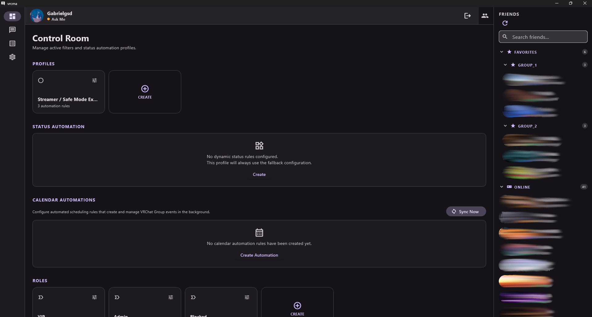
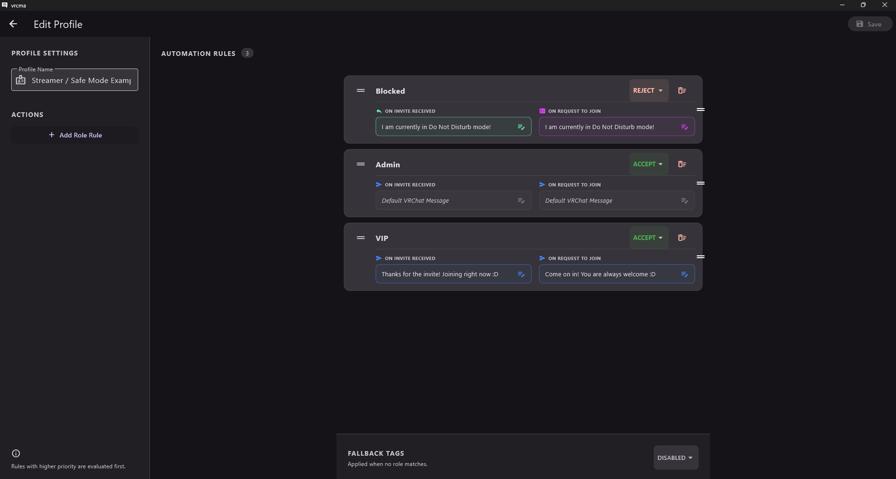
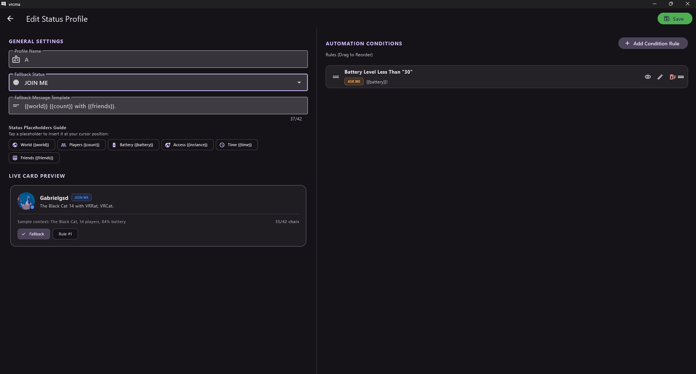
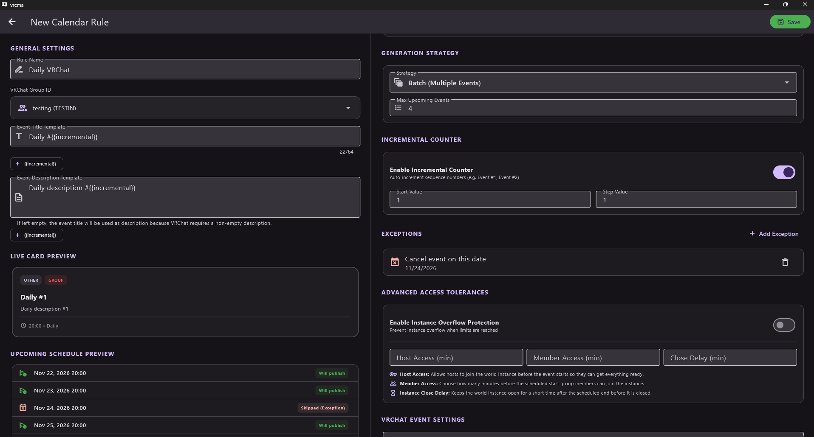
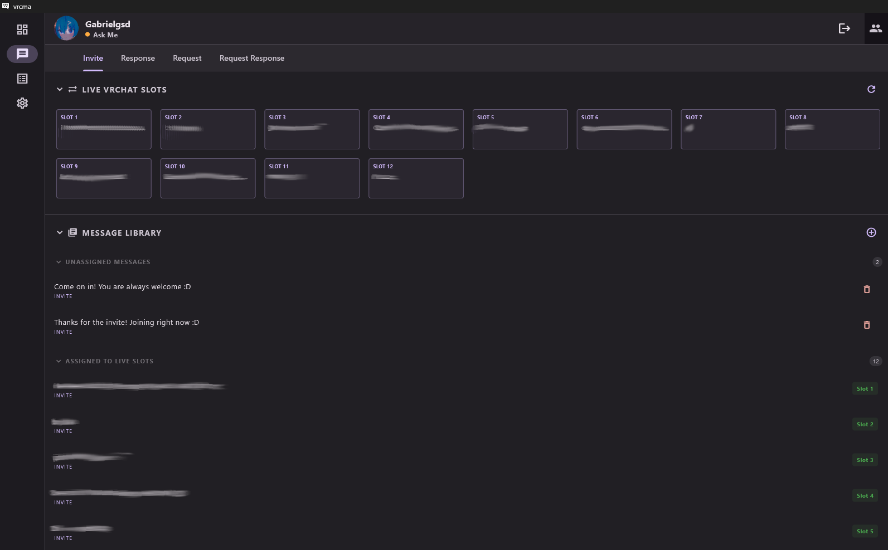
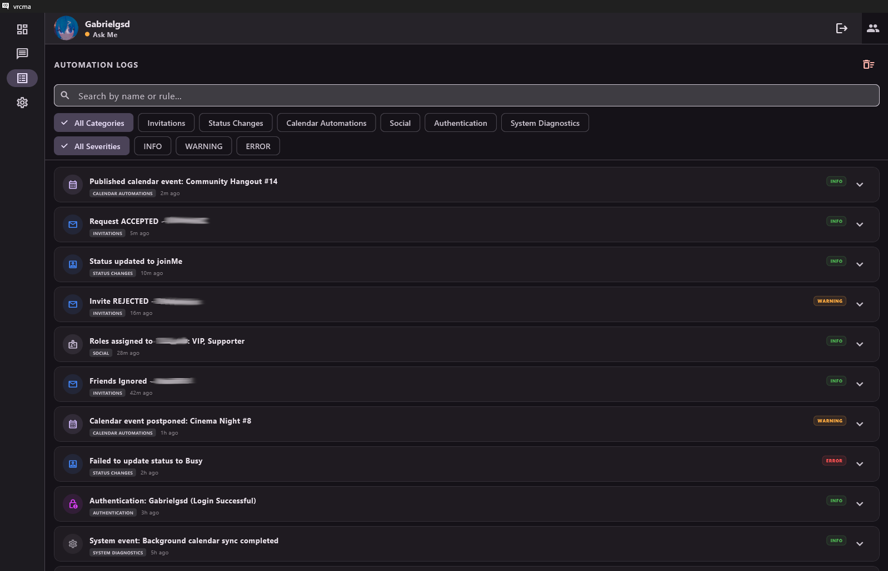

<p align="center">
  
</p>

<h1 align="center">VRCMA</h1>

<p align="center">
  <strong>VRChat Management Automation</strong>
</p>

<p align="center">
  <a href="https://flutter.dev"></a>
  <a href="https://dart.dev"></a>
  <a href="#getting-started"></a>
  <a href="LICENSE"></a>
</p>

<p align="center">
  A cross-platform companion app focused on <strong>automating repetitive VRChat account and group management tasks</strong> across desktop and mobile.
</p>

---

## Why VRCMA? (Is this a VRCX clone?)

**No — VRCMA is not a VRCX clone, nor does it aim to replace VRCX.**

[VRCX](https://github.com/vrcx-team/VRCX) is an outstanding desktop companion focused on social tracking, local game-log analytics, VR overlays, Discord Rich Presence, and activity history.

**VRCMA** exists to solve a different problem: **rule-based automation of repetitive VRChat management workflows** across both **Desktop and Mobile** — even while you are away from your PC:

* Instead of manually accepting or declining dozens of invites and join requests one by one, **VRCMA filters and responds automatically** using custom roles, priorities, VRChat tags, and synced message slots.
* Instead of editing your online status every time you switch worlds, run low on battery, or enter a private room, **VRCMA adapts your status and message dynamically**.
* Instead of manually recreating recurring VRChat Group events every week with incrementing episode numbers, **VRCMA plans, reconciles against `vrchat.com`, and publishes group calendar events automatically**.
* Built with **Flutter**, VRCMA runs natively on **Windows, Linux, Android, and iOS** (including an Android foreground background service so automations keep running when the app is minimized or closed).

You can happily use **VRCX** for tracking/overlays on PC and **VRCMA** for hands-free automation across your devices.

---

# Getting Started

## For Users

> **Pre-built binaries:** Check the [Releases](https://github.com/GabrielgsdCIUwU/VRCMA/releases) page *(if available)*, or follow [Building from Source](#building-from-source) below.

### Supported Platforms

| Platform | Local Database | Hardware Telemetry | Background Execution |
| :--- | :--- | :--- | :--- |
| **Windows** | SQLite (`sqflite_common_ffi`) | Battery via WMI (`Win32_Battery`) | While app is running |
| **Linux** | SQLite (`sqflite_common_ffi`) | Battery via `/sys/class/power_supply/` | While app is running |
| **Android** | SQLite (`sqflite`) | Native platform channel | Persistent foreground service |
| **iOS** | SQLite (`sqflite`) | Native platform channel | Background runtime |

### Quick Start
1. Launch VRCMA and sign in with your VRChat credentials (supports **2FA / TOTP / Email OTP** with persistent session cookies).
2. **(Optional)** Sync your existing **VRChat Message Slots** (`Invite`, `Response`, `Request`, `Request Response`) from the **Messages** tab.
3. Organize friends into **Roles** (e.g., `VIP`, `Admin`, `Blocked`) manually or automatically via **Friend Automations**.
4. Create and activate the automation profiles you need from the **Control Room (Dashboard)**.

---

# Features

- :incoming_envelope: **Automated Invite, Request & Friend Request Filtering**
    - Create multiple **Filter Profiles** (e.g., *Streamer Mode*, *Chill Mode*) and toggle the active one in a single click.
    - Evaluate incoming invites, join requests, and friend requests against priority-ordered **Role Rules** (`ACCEPT` or `REJECT`).
    - Configure **Fallback Tags** using official VRChat profile tags (Trust Ranks, VRC+ Supporter, Staff tags, and **60+ Language tags**) when no local role matches.
    - Attach custom templates to rules with **automatic 12-slot VRChat rotation (`MessageSlotManager`)** and two-way slot synchronization.
- :satellite: **Dynamic Status Automation**
    - Automatically switch your VRChat status (`Active`, `Join Me`, `Ask Me`, `Busy`) and status description based on prioritized conditions:
        - **Player Count** (`>`, `<`, `=`, `Between`)
        - **Instance Access Type** (`Public`, `Friends+`, `Friends`, `Invite+`, `Invite`, `Group`, etc.)
        - **Device Battery Level** (desktop laptops and mobile devices)
        - **Friend Role Presence** (detects when friends with a specific role are in your instance)
        - **Time Ranges** (supports overnight windows such as `22:00-06:00`)
        - **Current World ID** (exact match or world list)
    - Dynamic message placeholders: `{{world}}`, `{{count}}`, `{{battery}}`, `{{instance}}`, `{{time}}`, and `{{friends}}` (automatically clamped to VRChat's 42-character limit).
    - **Adaptive Signal Engine**: runs strictly event-driven over the VRChat WebSocket by default, activating 5-minute polling only when battery or time-based rules require it.
    - **Manual Override Protection**: automatically pauses status automation if you manually change your status inside VRChat.
- :calendar: **Group Calendar Automation**
    - Automatically schedule and publish VRChat Group events (`Once`, `Daily`, `Weekly`, `Monthly`) in your configured IANA timezone.
    - Validates group calendar management permissions (`group-calendar-manage` / owner) with a 48-hour local permission cache.
    - **Two Publishing Strategies**:
        - **Lazy**: maintains only the next upcoming event published on VRChat.
        - **Batch**: maintains up to *N* upcoming events visible in advance.
    - **Remote Reconciliation & Anti-Duplication**: inspects upcoming events already published on `vrchat.com` (`GET /calendar/{groupId}`) before creating anything, preventing duplicates from manual web edits or local resets.
    - Supports `{{incremental}}` counters in titles/descriptions, start/end date bounds, multi-day cancellation exceptions, live **Upcoming Schedule Preview**, VRChat rate-limit cooldown protection, and full event metadata (categories, visibility, platforms, notifications, early host/member join tolerances, overflow protection).
- :busts_in_silhouette: **Smart Friends Sidebar & Role Automation**
    - Categorizes friends into **Favorites**, **Same Instance** (auto-grouping 2+ friends in the same world with resolved world names), **Online**, **Active on Website**, and **Offline**.
    - Automatically assigns local roles when a **new friend** is detected or when a friend holds a specific **VRChat profile tag**.
- :iphone: **Mobile Background Service**
    - Keeps WebSocket invitation processing alive on Android via `flutter_background_service` with live foreground notification updates.
- :scroll: **Unified Audit & Diagnostics Logs**
    - Inspect every automated decision across `Invitations`, `Status Changes`, `Calendar Automations`, `Social`, `Authentication`, and `System Diagnostics`.
    - Filter by category, severity (`Info`, `Warning`, `Error`), or search query, with expandable technical metadata.
- :art: **Adaptive Material 3 UI & Localization**
    - Responsive layouts for desktop (`NavigationRail` + collapsible side panel) and mobile (`NavigationBar` + drawer).
    - Light / Dark / System theme modes with customizable accent colors.
    - Built-in localization for **English (`en`)** and **Spanish (`es`)**.

---

# Screenshots

<div align="center">


<h3>Control Room & Friends</h3>


<h3>Filter & Status Automation Editors</h3>
<table>
  <tr>
    <td align="center"></td>
    <td align="center"></td>
  </tr>
</table>

<h3>Group Calendar Automation</h3>


<h3>Messages & Unified Logs</h3>
<table>
  <tr>
    <td align="center"></td>
    <td align="center"></td>
  </tr>
</table>

</div>

---

# For Developers: Architecture & Setup

VRCMA follows **Clean Architecture** combined with **Riverpod 3** (`riverpod_annotation`) and a local **SQLite** persistence layer.

## Tech Stack
* **Framework:** Flutter (Material 3, responsive desktop & mobile layouts)
* **State Management & DI:** `flutter_riverpod` + `riverpod_annotation` + `riverpod_generator`
* **VRChat API & Streaming:** `vrchat_dart` (`^5.0.0`) + `dio` + `cookie_jar` / `dio_cookie_manager`
* **Local Persistence:** `sqflite` / `sqflite_common_ffi` (`vrcma_database.db` with WAL mode & foreign keys enabled)
* **Timezones & Localization:** `timezone`, `flutter_timezone`, `intl`, `flutter_localizations` (`.arb` files)
* **Functional & Value Equality:** `dartz` (`Either<Failure, T>`), `equatable`
* **Testing:** `flutter_test`, `mockito`, `sqflite_common_ffi` (in-memory SQLite tests)

## Project Structure

```text
lib/
├── main.dart                         # App entry point, timezone & platform DB/BG initialization
├── core/
│   ├── database/                     # SQLite schema, migrations, and initial seed data
│   ├── di/                           # Riverpod providers for storage, network, and use cases
│   ├── errors/                       # Application Failure types
│   ├── l10n/                         # Localization ARBs (en, es) & generated classes
│   ├── network/                      # Resilient Dio JSON sanitizer interceptor & rules
│   ├── services/                     # Background execution service & battery factory
│   └── theme/                        # Material 3 ThemeExtension semantic colors
├── data/
│   ├── mappers/                      # SQLite <-> Domain & VRChat API mappers
│   ├── models/                       # API-adapted data models (e.g., VrcUserModel)
│   ├── repositories/                 # Concrete implementations (SQLite & VRChat API)
│   ├── services/                     # Platform-specific battery implementations
│   └── transformers/                 # WebSocket payload -> Domain event transformers
├── domain/
│   ├── entities/                     # Pure domain entities, enums, and value objects
│   ├── error/                        # Typed DomainException hierarchy
│   ├── mappers/                      # Base database mapper contract
│   ├── repositories/                 # Abstract repository interfaces
│   ├── services/                     # Pure domain services (OccurrenceCalculator, AppLogger, etc.)
│   └── usecases/                     # Business logic orchestrators & handlers
└── presentation/
    ├── extensions/                   # Localized UI extensions for enums, entities, errors
    ├── pages/                        # LoginPage & HomePage
    ├── services/                     # Global SnackBar service
    ├── state/                        # Riverpod Notifiers & AsyncNotifiers
    └── widgets/                      # Reusable & responsive UI panels and editor sheets
```

## Building from Source

### Prerequisites
* [Flutter SDK](https://docs.flutter.dev/get-started/install) (Dart SDK `^3.11.0`)
* Platform toolchain for your target OS:
    * **Windows:** Visual Studio with *Desktop development with C++*
    * **Linux:** `clang`, `cmake`, `ninja-build`, `pkg-config`, `libgtk-3-dev`, `libsqlite3-dev`
    * **Android:** Android SDK + JDK 17

### Setup & Code Generation

1. **Clone the repository:**
   ```bash
   git clone https://github.com/GabrielgsdCIUwU/VRCMA.git
   cd VRCMA
   ```

2. **Install dependencies:**
   ```bash
   flutter pub get
   ```

3. **Generate localizations and Riverpod / Mockito code:**
   ```bash
   flutter gen-l10n
   dart run build_runner build --delete-conflicting-outputs
   ```

4. **Run static analysis and unit tests:**
   ```bash
   flutter analyze
   flutter test
   ```

5. **Run the app:**
   ```bash
   flutter run
   ```

## Coding Standards & Architecture Rules

To keep the codebase maintainable and easy to review, all pull requests should follow these conventions:

* **Strict Layer Separation:**
    * `domain/` must remain pure Dart/business logic with **zero imports** from `flutter/material.dart`, `sqflite`, or `vrchat_dart`.
    * Keep SQLite row mapping inside `lib/data/mappers/` implementing `IDatabaseMapper<T>` (never mix raw SQL column keys into domain entities or UI widgets).
    * Place domain enums under `lib/domain/entities/<feature>/enums/` and domain validation errors under `lib/domain/error/`.
* **Readable, Low-Complexity Code:**
    * Keep control-flow nesting shallow (**maximum 3 indentation levels**). Prefer early returns, guard clauses, and small private helper methods.
    * Keep methods focused on a single responsibility (SRP).
    * **Never** use SQLite `ConflictAlgorithm.replace` on tables referenced by `ON DELETE CASCADE` foreign keys; use explicit `UPDATE` or `ON CONFLICT DO UPDATE`.
* **Documentation & Naming:**
    * Write all code, identifiers, `///` docstrings on classes/public APIs, and explanatory comments in **English**.
* **Code Generation & Verification:**
    * Re-run `dart run build_runner build --delete-conflicting-outputs` whenever modifying `@riverpod` providers or `@GenerateMocks` in `test/helpers/test_mocks.dart`.
    * Mirror the `lib/` folder hierarchy in `test/` and ensure both `flutter analyze` and `flutter test` pass with zero issues before opening a PR.

---

## Adding a New Language (Localization Guide)

VRCMA uses Flutter's official `gen-l10n` pipeline with `.arb` files located in `lib/core/l10n/arb/`.
`app_en.arb` is the **source template** containing all keys, descriptions, and placeholder definitions.

### Step-by-Step for Translators

1. **Copy the template file:**
   Duplicate `lib/core/l10n/arb/app_en.arb` as `lib/core/l10n/arb/app_<lang>.arb` (e.g., `app_fr.arb`, `app_ja.arb`, `app_de.arb`).
2. **Set the locale header:**
   Update `"@@locale"` at the top of your new file:
   ```json
   {
     "@@locale": "fr",
     "loginTitle": "VRCMA",
     ...
   }
   ```
   *(You can omit the `@key` metadata blocks in translation files—keep only `"@@locale"` and the translated string keys, with no duplicate keys.)*
3. **Follow ICU placeholder & quoting rules carefully:**
    * **Keep `{placeholder}` names exact** (e.g., `{roleName}`, `{count}`, `{minutes}`). Do not translate placeholder identifiers.
    * **Preserve plural syntax** where used (e.g., `{count, plural, =1{...} other{...}}`).
    * **Single quotes escape `{...}` in ICU!** If your translation needs literal quotes around a variable or placeholder text (like `''{name}''` or `'{{world}}'`), use **two single quotes `''`** around `{name}`, otherwise Flutter will print `{name}` literally instead of its value.
    * **Do not translate technical template tags** such as `{{world}}`, `{{count}}`, `{{battery}}`, `{{instance}}`, `{{time}}`, `{{friends}}`, or `{{incremental}}`.
4. **Set the native language name inside your `.arb`:**
   Translate `"languageNativeName"` in your new `.arb` file (e.g., `"Français"`, `"日本語"`, `"Deutsch"`) so it appears automatically in the Settings language dropdown—no Dart code changes required.
5. **Regenerate and verify:**
   ```bash
   flutter gen-l10n
   flutter analyze
   flutter test
   ```

---

## Is VRCMA against VRChat's TOS?

**No.**

VRCMA is an external companion application that communicates exclusively through the official VRChat HTTP and WebSocket APIs.

* It does **not** modify, inject into, or hook the VRChat game client in any way. It is not a mod or a cheat.
* It incorporates rate-limit safeguards, local caching, passive WebSocket listening, and strict request spacing to use the VRChat API responsibly.
* To review VRChat's official stance on third-party API tools, check the `#faq` channel in the VRChat Discord.

---

VRCMA is not endorsed by VRChat and does not reflect the views or opinions of VRChat or anyone officially involved in producing or managing VRChat properties. VRChat and all associated properties are trademarks or registered trademarks of VRChat Inc. VRChat © VRChat Inc.